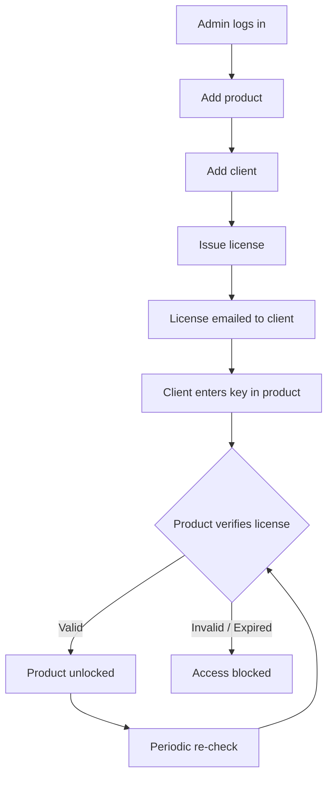

# Opezee License Management System

## Project Overview

Opezee License Management System is a central platform to create, issue and control software licenses for Opezee products. Admins use a web dashboard to manage products, clients and licenses, and each Opezee product connects to the system to check whether its license is valid before it can be used.

## Use Cases

### Actors

| Actor | Role |
| --- | --- |
| **Admin** | Manages products, clients and licenses from the dashboard |
| **Client** | Receives the license and uses the Opezee product |
| **Product** | Opezee software that checks its license with the system |

### Admin

| Use Case | Description |
| --- | --- |
| Login | Sign in to the admin dashboard |
| Manage products | Add, edit or delete products |
| Manage clients | Add, edit or delete clients |
| Issue license | Create a license for a client and product with an expiry date |
| Send license | Email the license key to the client |
| Manage licenses | Edit, change status of, or delete licenses |
| View dashboard | See license counts and status |

### Client

| Use Case | Description |
| --- | --- |
| Receive license | Get the license key by email |
| Activate product | Enter the license key in the product |

### Product

| Use Case | Description |
| --- | --- |
| Verify license | Check the license key is valid before use |
| Re-check license | Re-validate the license periodically |

## Project Flow

1. Admin logs in to the dashboard.
2. Admin adds the product and the client.
3. Admin issues a license for the client and product.
4. The license key is emailed to the client.
5. Client enters the key in the product.
6. Product verifies the license — valid keys unlock the product, invalid or expired keys are blocked.
7. Product re-checks the license periodically while in use.

## Database

Data is stored in **MongoDB** (it previously lived in Firebase Firestore). By default the
server connects to a local MongoDB at `mongodb://127.0.0.1:27017`, database
`opezee_licenses`. Override with `MONGODB_URI` and `MONGODB_DB` in `.env`.

| Command | What it does |
| --- | --- |
| `npm run backup-db` | Exports every collection to `backups/mongodb-<timestamp>/` as JSON |
| `npm run restore-db` | Loads the newest backup folder into MongoDB (upserts by id, safe to re-run) |
| `npm run restore-db -- <folder>` | Loads a specific backup folder |
| `npm run create-admin` | Creates or resets the dashboard admin login |
| `npm test` | Runs the API tests against a throwaway database on the local MongoDB |

The `backups/` folder is git-ignored because it contains password hashes.
